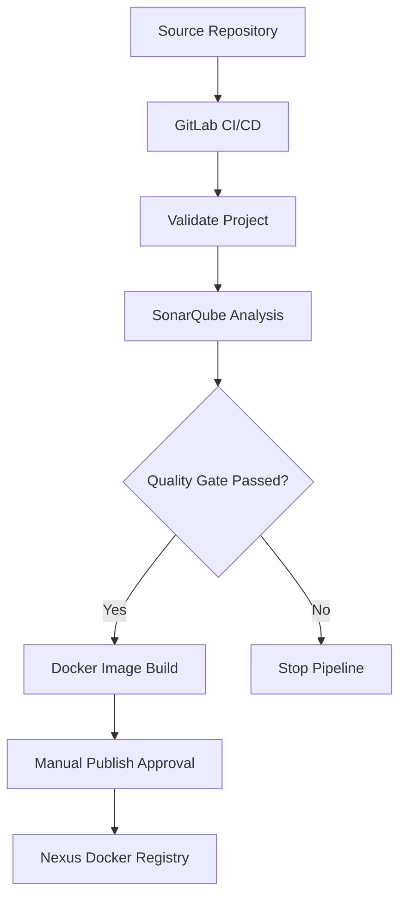

# Infrastructure Automation & CI/CD

### Ansible | GitLab CI/CD | Docker | Nexus | SonarQube

## Overview

This repository showcases infrastructure automation and CI/CD practices based on hands-on experience with enterprise IT systems and DevOps tooling.

It combines Ansible automation, containerized applications, GitLab CI/CD pipelines, code quality analysis, and artifact management.

The project includes technical documentation and reproducible configuration examples. The public examples are currently awaiting validation in an isolated lab environment.

## Technology Stack

| Technology | Purpose |
|---|---|
| Ansible | Infrastructure automation and configuration |
| GitLab CI/CD | Pipeline orchestration |
| GitLab Runner | Pipeline execution |
| Docker | Application containerization |
| Docker Compose | Local container deployment |
| SonarQube | Static analysis and quality gates |
| Nexus Repository | Private Docker registry |
| Nginx | Demonstration web application |
| Debian Linux | Target lab environment |

## Technical Projects

### 1. Infrastructure Automation with Ansible

The Ansible examples demonstrate repeatable configuration of Debian-based web servers.

| File | Description |
|---|---|
| [Install Nginx](ansible/playbooks/install-nginx.yml) | Install and enable Nginx |
| [Configure Nginx](ansible/playbooks/configure-nginx.yml) | Deploy a sample page using variables and a handler |
| [Inventory](ansible/inventory/hosts.ini) | Example target hosts and SSH settings |
| [Ansible Configuration](ansible/ansible.cfg) | Controller configuration and privilege escalation |

Key concepts:

- Infrastructure configuration automation
- Reusable playbooks
- Variables and handlers
- Idempotent operations
- SSH-based server management

### 2. Docker & Container Deployment

A lightweight Nginx web application is provided as a demonstration workload.

| File | Description |
|---|---|
| [Dockerfile](docker/Dockerfile) | Nginx-based container image |
| [Demo Web Application](docker/index.html) | Sample HTML page |
| [Docker Compose](docker/compose.yaml) | Local deployment with health checks |

The Compose example publishes the application on localhost port 8080.

Planned lab command, executed from the repository root:

```bash
docker compose -f docker/compose.yaml up -d --build
```

Expected local endpoint:

`http://localhost:8080`

This deployment has not yet been validated in the lab.

### 3. GitLab CI/CD Pipelines

The repository contains separate examples for different CI/CD workflows.

| Pipeline | Purpose |
|---|---|
| [Basic CI/CD](gitlab-ci/.gitlab-ci.yml) | Validate, build artifact, simulate deployment |
| [Docker Build](gitlab-ci/docker-build.gitlab-ci.yml) | Build and inspect a container image |
| [Docker + Nexus](gitlab-ci/docker-nexus.gitlab-ci.yml) | Build and publish to a private registry |
| [SonarQube](gitlab-ci/sonarqube.gitlab-ci.yml) | Static analysis and quality gate |
| [Integrated Pipeline](gitlab-ci/integrated-pipeline.gitlab-ci.yml) | Validate, analyze, build, publish |

These are alternative pipeline examples, not five pipelines that execute automatically.

GitLab must be configured to use the selected CI/CD configuration file.

### 4. Integrated CI/CD Workflow

The integrated example combines validation, SonarQube analysis, Docker image creation, and publication to Nexus.



The publish stage requires manual approval on the default branch.

The current example rebuilds the image during publication. A future improvement will promote an immutable image artifact or digest rather than rebuilding it.

For technical details, see:

[Infrastructure Automation & CI/CD Architecture](docs/cicd-architecture.md)

## Repository Structure

```text
infrastructure-automation-cicd/
├── ansible/
│   ├── ansible.cfg
│   ├── inventory/
│   │   └── hosts.ini
│   └── playbooks/
│       ├── install-nginx.yml
│       └── configure-nginx.yml
├── docker/
│   ├── Dockerfile
│   ├── compose.yaml
│   └── index.html
├── gitlab-ci/
│   ├── .gitlab-ci.yml
│   ├── docker-build.gitlab-ci.yml
│   ├── docker-nexus.gitlab-ci.yml
│   ├── sonarqube.gitlab-ci.yml
│   └── integrated-pipeline.gitlab-ci.yml
├── docs/
│   └── cicd-architecture.md
└── README.md
```

## Security Considerations

- No production credentials or internal server addresses are included.
- Inventory IP addresses are documentation-only examples.
- GitLab secrets must be stored in protected CI/CD variables.
- Registry communication should use HTTPS.
- Docker-in-Docker requires careful Runner isolation.
- All deployment examples require review before production use.

## Project Roadmap

### Documentation & Examples — Completed

- [x] Create Ansible installation playbook
- [x] Create Ansible configuration playbook
- [x] Add sample inventory and controller configuration
- [x] Create Dockerfile and sample application
- [x] Add Docker Compose configuration
- [x] Document basic GitLab CI/CD workflow
- [x] Add Docker image build pipeline
- [x] Add Nexus registry integration example
- [x] Add SonarQube quality gate example
- [x] Create integrated CI/CD pipeline
- [x] Document CI/CD architecture

### Planned Improvements

- [ ] Add Ansible roles and Jinja2 templates
- [ ] Add pipeline syntax validation
- [ ] Add container image vulnerability scanning
- [ ] Improve image promotion using immutable artifacts
- [ ] Add automated deployment to a test environment
- [ ] Add execution logs and screenshots

### Lab Validation — Pending

- [ ] Prepare Debian test machines
- [ ] Run and verify Ansible playbooks
- [ ] Build and run the Docker application
- [ ] Set up an isolated GitLab Runner
- [ ] Validate GitLab pipeline syntax and execution
- [ ] Test SonarQube quality gate integration
- [ ] Configure Nexus Docker Registry
- [ ] Push and pull container images
- [ ] Validate the integrated CI/CD workflow

## Implementation Status

The configuration files and documentation are available in this repository.

They demonstrate the intended automation and delivery workflow, but successful end-to-end execution has not yet been demonstrated in the public lab.

Future updates will include validated configuration files, execution evidence, and troubleshooting notes.

## About

This portfolio highlights experience and ongoing development in IT Infrastructure Engineering, configuration automation, CI/CD operations, containerization, and DevOps tooling.

The goal is to build a documented, reproducible infrastructure automation environment that connects practical operations experience with automated delivery workflows.
