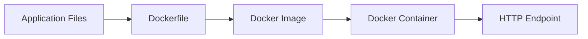
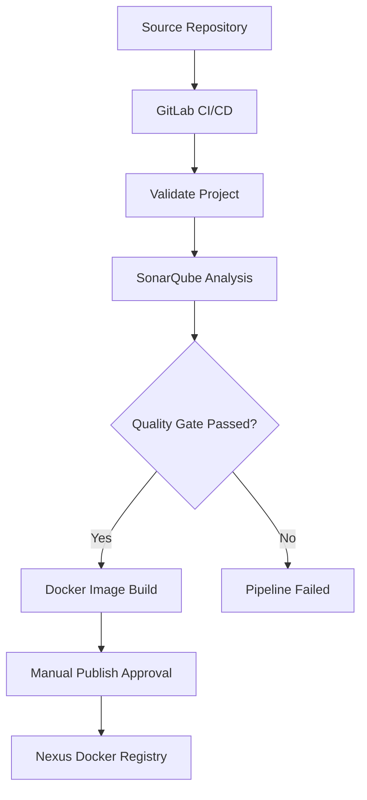

# Infrastructure Automation & CI/CD

### Ansible | GitLab CI/CD | Docker | Nexus | SonarQube

## Overview

This repository showcases infrastructure automation and CI/CD engineering practices, combining experience with enterprise IT systems, configuration management, containerization, automated delivery workflows, code quality analysis, and artifact management.

The portfolio includes reusable Ansible playbooks, Docker configurations, GitLab CI/CD pipeline examples, and technical architecture documentation.

The primary objective is to demonstrate how infrastructure automation and application delivery components can be organized into a consistent, maintainable workflow.

## Technology Stack

| Technology | Purpose |
|---|---|
| Ansible | Infrastructure automation and configuration management |
| GitLab CI/CD | Pipeline orchestration |
| GitLab Runner | Pipeline execution |
| Docker | Application containerization |
| Docker Compose | Container deployment |
| SonarQube | Static code analysis and quality gates |
| Nexus Repository | Private container image registry |
| Nginx | Demonstration web application |
| Debian Linux | Target infrastructure environment |

## 1. Infrastructure Automation with Ansible

The Ansible configuration examples demonstrate repeatable installation and configuration of Debian-based web servers.

### Project Files

| File | Description |
|---|---|
| [Install Nginx](ansible/playbooks/install-nginx.yml) | Install and enable Nginx |
| [Configure Nginx](ansible/playbooks/configure-nginx.yml) | Configure Nginx and deploy a sample page |
| [Inventory](ansible/inventory/hosts.ini) | Example inventory and SSH settings |
| [Ansible Configuration](ansible/ansible.cfg) | Controller configuration and privilege escalation |

### Engineering Concepts

- Infrastructure configuration automation
- Repeatable deployment procedures
- Ansible inventories
- Variables and handlers
- Idempotent configuration management
- SSH-based Linux administration

### Example Playbook Execution

Run from the repository root:

```bash
cd ansible
ansible-playbook playbooks/install-nginx.yml
ansible-playbook playbooks/configure-nginx.yml
```

Configure the inventory and SSH access for the target environment before execution.

## 2. Docker & Container Deployment

The repository includes a lightweight Nginx web application as a demonstration workload.

### Project Files

| File | Description |
|---|---|
| [Dockerfile](docker/Dockerfile) | Nginx-based container image |
| [Sample Application](docker/index.html) | Demonstration HTML application |
| [Docker Compose](docker/compose.yaml) | Local container deployment and health checks |

### Container Workflow



### Example Deployment

From the repository root:

```bash
docker compose -f docker/compose.yaml up -d --build
```

Application endpoint:

`http://localhost:8080`

### Example Container Management

View container status:

```bash
docker compose -f docker/compose.yaml ps
```

View logs:

```bash
docker compose -f docker/compose.yaml logs
```

Stop the deployment:

```bash
docker compose -f docker/compose.yaml down
```

The deployment demonstrates a basic container lifecycle using Docker Compose.

## 3. GitLab CI/CD Pipelines

The repository provides separate GitLab CI/CD configuration examples for different automation scenarios.

### Pipeline Examples

| Pipeline | Purpose |
|---|---|
| [Basic CI/CD](gitlab-ci/.gitlab-ci.yml) | Validation, artifact creation, and deployment workflow example |
| [Docker Build](gitlab-ci/docker-build.gitlab-ci.yml) | Docker image build and inspection |
| [Docker + Nexus](gitlab-ci/docker-nexus.gitlab-ci.yml) | Container image build and registry publication |
| [SonarQube](gitlab-ci/sonarqube.gitlab-ci.yml) | Static analysis and quality gate |
| [Integrated Pipeline](gitlab-ci/integrated-pipeline.gitlab-ci.yml) | Validation, analysis, build, and publication |

These files represent alternative CI/CD configurations.

A GitLab project must be configured to use the selected CI/CD configuration file.

### CI/CD Engineering Concepts

- Pipeline stages and jobs
- GitLab Runner execution
- Automated validation
- Docker image creation
- Static code analysis
- Quality gates
- Container registry integration
- Manual publication approval
- CI/CD variables and credentials

## 4. Integrated CI/CD Architecture

The integrated pipeline combines project validation, code quality analysis, container image creation, and registry publication.



### Pipeline Stages

**Validation**

Checks project files and prepares the workflow for subsequent stages.

**Code Quality**

Uses SonarQube analysis and quality gate evaluation.

**Container Build**

Builds the demonstration application container image.

**Publication**

Provides a manually approved stage for publishing a container image to Nexus Repository.

### Artifact Management

Nexus Repository provides a central location for storing and distributing container images.

Registry integration requires:

- Registry endpoint configuration
- Authentication credentials
- Appropriate repository permissions
- Secure transport
- Image naming and tagging conventions

### Image Promotion

A stronger CI/CD design promotes an immutable image or digest between pipeline stages rather than rebuilding the container during publication.

This improves traceability and consistency between the built and published artifacts.

For architecture details:

[Infrastructure Automation & CI/CD Architecture](docs/cicd-architecture.md)

## 5. Repository Structure

```text
infrastructure-automation-cicd/
├── ansible/
│   ├── ansible.cfg
│   ├── inventory/
│   │   └── hosts.ini
│   └── playbooks/
│       ├── install-nginx.yml
│       └── configure-nginx.yml
├── docker/
│   ├── Dockerfile
│   ├── compose.yaml
│   └── index.html
├── gitlab-ci/
│   ├── .gitlab-ci.yml
│   ├── docker-build.gitlab-ci.yml
│   ├── docker-nexus.gitlab-ci.yml
│   ├── sonarqube.gitlab-ci.yml
│   └── integrated-pipeline.gitlab-ci.yml
├── docs/
│   └── cicd-architecture.md
└── README.md
```

## 6. Security Considerations

Infrastructure automation and CI/CD systems require appropriate security controls.

Key considerations:

- Protect SSH private keys and authentication credentials.
- Use protected and masked GitLab CI/CD variables.
- Apply least-privilege permissions to automation accounts.
- Restrict GitLab Runner access to trusted workloads.
- Use HTTPS for container registry communication.
- Protect Nexus credentials and access tokens.
- Review Docker-in-Docker security implications.
- Avoid exposing internal infrastructure addresses.
- Do not commit production secrets or confidential configuration files.

## 7. Engineering Best Practices

### Ansible

- Maintain reusable playbooks.
- Prefer idempotent operations.
- Use inventory variables for environment-specific configuration.
- Protect sensitive variables.
- Review changes before applying them to managed hosts.

### Docker

- Use minimal base images where appropriate.
- Maintain explicit image versions.
- Include meaningful health checks.
- Avoid storing secrets in container images.
- Review container resource requirements.

### GitLab CI/CD

- Separate validation, analysis, build, and publication stages.
- Use appropriate pipeline failure conditions.
- Protect publishing credentials.
- Apply manual approval to sensitive operations.
- Preserve artifact traceability.
- Keep deployment permissions restricted.

### SonarQube

- Define relevant quality gate conditions.
- Use automated analysis in CI workflows.
- Review code quality findings before publication.

### Nexus Repository

- Use authenticated registry access.
- Maintain clear repository permissions.
- Apply appropriate image retention policies.
- Use consistent versioning and tagging conventions.

## 8. Technical Development Areas

The architecture supports further development in:

- Ansible roles and Jinja2 templates
- Pipeline syntax checking
- Automated container vulnerability scanning
- Immutable artifact promotion
- Environment-specific deployment workflows
- Pipeline reporting and execution evidence
- Improved configuration reuse
- CI/CD security controls

## 9. Professional Focus

This repository highlights technical knowledge and engineering practices relevant to:

- IT Infrastructure Engineering
- Systems Administration
- Infrastructure Automation
- Configuration Management
- CI/CD Operations
- Containerization
- DevOps Tooling

The project connects enterprise infrastructure experience with repeatable automation and application delivery workflows.

## 10. References

- [Ansible Documentation](https://docs.ansible.com/)
- [GitLab CI/CD Documentation](https://docs.gitlab.com/ci/)
- [Docker Documentation](https://docs.docker.com/)
- [SonarQube Documentation](https://docs.sonarsource.com/)
- [Sonatype Nexus Repository Documentation](https://help.sonatype.com/)

## About

A technical portfolio focused on infrastructure automation, GitLab CI/CD, Docker, Ansible, SonarQube, Nexus Repository, and repeatable operational workflows.
