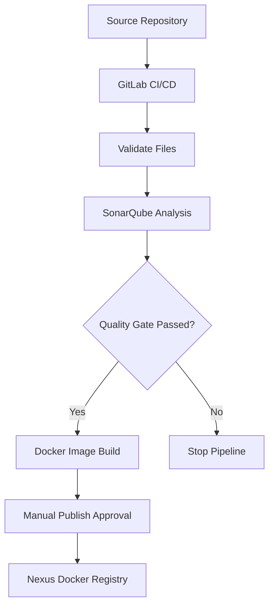

# Infrastructure Automation & CI/CD Architecture

## 1. Project Overview

This project demonstrates an infrastructure automation and CI/CD workflow using Ansible, GitLab CI/CD, Docker, SonarQube, and Nexus Repository.

The examples are informed by practical experience with enterprise infrastructure and DevOps tooling.

The public configurations are portfolio examples and have not yet been validated together in an isolated lab.

## 2. CI/CD Architecture



This is the intended workflow of the integrated pipeline.

Actual execution depends on the availability and configuration of a GitLab Runner, SonarQube, Docker, and Nexus.

## 3. Technology Stack

| Component | Purpose |
|---|---|
| GitLab CI/CD | Pipeline orchestration |
| GitLab Runner | CI/CD job execution |
| Docker | Container image creation |
| SonarQube | Static code analysis and quality gates |
| Nexus Repository | Private Docker image registry |
| Ansible | Infrastructure provisioning and configuration |

## 4. CI/CD Workflow

### Stage 1 — Validate

The pipeline checks whether required project files exist:

- Dockerfile
- Application HTML file
- Docker Compose configuration

This stage verifies the presence of files, not application correctness.

### Stage 2 — Analyze

SonarScanner submits the configured source files to SonarQube.

The pipeline waits for the Quality Gate result before continuing.

The current demonstration application is small, so static analysis coverage is limited.

### Stage 3 — Build

A GitLab Runner builds a Docker image using the repository's Dockerfile.

The image is tagged using the short Git commit SHA.

Example image tag:

`infrastructure-demo:<commit-sha>`

The build uses Docker-in-Docker in an isolated CI environment.

### Stage 4 — Publish

The publish job is configured as a manual step on the default branch.

After authorization, the job:

1. Authenticates to the Nexus Docker Registry.
2. Rebuilds and tags the Docker image.
3. Pushes the image to Nexus.
4. Logs out of the registry.

The current implementation rebuilds the image during publication because each CI job has an isolated Docker daemon.

For production use, artifact promotion by immutable digest would provide stronger consistency between tested and published images.

## 5. Infrastructure Automation

Ansible is maintained as a separate component of this portfolio.

The current examples include:

- Inventory configuration
- Ansible controller settings
- Nginx installation
- Nginx configuration
- Variables and handlers

Ansible deployments are not yet integrated into the CI/CD pipeline.

## 6. Security Considerations

### Credentials

Sensitive values must be stored in GitLab CI/CD variables rather than committed to source control.

Examples include:

- `SONAR_HOST_URL`
- `SONAR_TOKEN`
- `NEXUS_REGISTRY`
- `NEXUS_USERNAME`
- `NEXUS_PASSWORD`

### Runner Security

Docker-in-Docker commonly requires privileged Runner configuration.

This creates additional security risks.

The example should be executed only in an isolated lab with a dedicated Runner.

### Registry Security

- Use HTTPS for Registry communication.
- Restrict credentials to necessary permissions.
- Avoid publishing credentials in logs.
- Review container images for vulnerabilities.

## 7. Repository Structure

```text
infrastructure-automation-cicd/
├── ansible/
│   ├── ansible.cfg
│   ├── inventory/
│   │   └── hosts.ini
│   └── playbooks/
│       ├── install-nginx.yml
│       └── configure-nginx.yml
├── docker/
│   ├── Dockerfile
│   ├── index.html
│   └── compose.yaml
├── gitlab-ci/
│   ├── .gitlab-ci.yml
│   ├── docker-build.gitlab-ci.yml
│   ├── docker-nexus.gitlab-ci.yml
│   ├── sonarqube.gitlab-ci.yml
│   └── integrated-pipeline.gitlab-ci.yml
└── docs/
    └── cicd-architecture.md
```

## 8. Current Implementation Status

| Component | Status |
|---|---|
| Ansible playbook examples | Created, untested |
| Ansible inventory and configuration | Created, untested |
| Dockerfile and sample application | Created, untested |
| Docker Compose configuration | Created, untested |
| GitLab CI/CD examples | Created, untested |
| SonarQube integration example | Created, untested |
| Nexus integration example | Created, untested |
| Integrated CI/CD pipeline | Created, untested |
| End-to-end pipeline execution | Pending lab validation |

## 9. Future Lab Validation

- [ ] Prepare an isolated GitLab Runner
- [ ] Validate pipeline syntax using GitLab CI Lint
- [ ] Build the Docker image successfully
- [ ] Run and health-check the application
- [ ] Configure SonarQube connectivity
- [ ] Validate Quality Gate behavior
- [ ] Configure a private Nexus Docker Registry
- [ ] Push and pull a versioned container image
- [ ] Execute Ansible playbooks on a Debian test VM
- [ ] Capture screenshots and execution logs

## 10. Lessons Learned

Infrastructure automation and CI/CD require more than individual tools.

A reliable workflow must address configuration consistency, code quality, artifact management, credential protection, and repeatable delivery.

This project provides a foundation for documenting and validating those practices in a reproducible environment.
