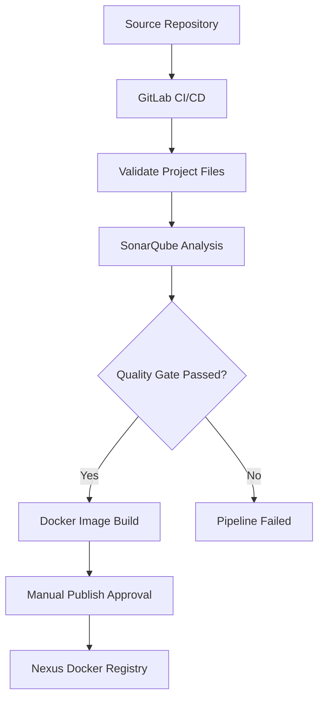
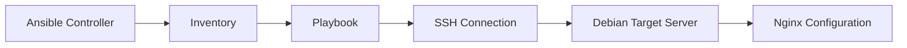
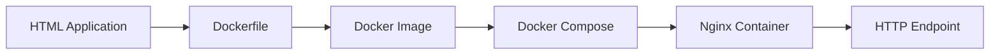
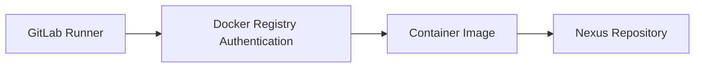

# Infrastructure Automation & CI/CD Architecture

## 1. Overview

This document describes an infrastructure automation and continuous integration/continuous delivery architecture using Ansible, GitLab CI/CD, Docker, SonarQube, and Nexus Repository.

The project combines reusable infrastructure configuration examples with container-based application delivery workflows.

The architecture focuses on:

- Automated project validation
- Static code analysis
- Quality gate enforcement
- Docker image creation
- Controlled artifact publication
- Infrastructure configuration using Ansible
- CI/CD security and credential management

The configuration examples are informed by practical experience with enterprise infrastructure and DevOps tooling.

## 2. CI/CD Architecture



The diagram illustrates the workflow defined by the integrated pipeline example.

Pipeline execution requires appropriately configured GitLab Runners and access to the supporting services.

## 3. Technology Stack

| Component | Responsibility |
|---|---|
| GitLab | Source control and CI/CD orchestration |
| GitLab Runner | Pipeline job execution |
| Docker | Container image build |
| Docker-in-Docker | Docker operations inside CI jobs |
| SonarQube | Static analysis and quality gate evaluation |
| Nexus Repository | Private Docker image registry |
| Ansible | Infrastructure automation and configuration |
| Nginx | Demonstration application |

## 4. CI/CD Workflow

### Stage 1 — Validate

The validation stage checks the presence of required project files.

Examples include:

- `docker/Dockerfile`
- `docker/index.html`
- `docker/compose.yaml`

This stage verifies project structure and required files. It does not replace application functional testing.

### Stage 2 — Analyze

SonarScanner submits the configured project files to SonarQube.

The analysis stage provides:

- Static code analysis
- Quality reporting
- Quality gate evaluation
- Pipeline failure handling when the quality gate fails

The pipeline waits for the quality gate result before proceeding to the build stage.

### Stage 3 — Build

The build stage creates a Docker image using the project Dockerfile.

The image is tagged using the short Git commit SHA.

Example:

```text
infrastructure-demo:<commit-sha>
```

This naming approach links the image tag to a specific source revision.

The pipeline uses Docker-in-Docker for container build operations.

### Stage 4 — Publish

The publication stage requires manual approval on the default branch.

The example workflow:

1. Authenticates to the Nexus Docker Registry.
2. Builds and tags the container image for the registry.
3. Pushes the image to Nexus.
4. Logs out of the registry.

The integrated example performs a separate image build in the publication job because CI jobs use isolated Docker environments.

For stronger artifact traceability, an improved workflow can transfer an existing image artifact or promote an immutable image digest instead of rebuilding it.

## 5. Repository Pipeline Examples

| File | Purpose |
|---|---|
| [Basic CI/CD](../gitlab-ci/.gitlab-ci.yml) | Validation, artifact creation and deployment workflow |
| [Docker Build](../gitlab-ci/docker-build.gitlab-ci.yml) | Container image build and inspection |
| [Docker + Nexus](../gitlab-ci/docker-nexus.gitlab-ci.yml) | Image publication to Nexus |
| [SonarQube](../gitlab-ci/sonarqube.gitlab-ci.yml) | Code analysis and quality gate |
| [Integrated Pipeline](../gitlab-ci/integrated-pipeline.gitlab-ci.yml) | Combined validation, analysis, build and publication |

These files demonstrate alternative pipeline configurations.

A GitLab project must reference the appropriate configuration file to execute the selected workflow.

## 6. Infrastructure Automation with Ansible

Ansible provides a separate infrastructure configuration component within the portfolio.

### Components

- Inventory configuration
- Ansible controller settings
- Nginx installation playbook
- Nginx configuration playbook
- Variables and handlers

### Configuration Workflow



### Project Files

- [Ansible Configuration](../ansible/ansible.cfg)
- [Inventory](../ansible/inventory/hosts.ini)
- [Install Nginx](../ansible/playbooks/install-nginx.yml)
- [Configure Nginx](../ansible/playbooks/configure-nginx.yml)

The Ansible examples operate independently of the GitLab CI/CD pipeline configuration.

Ansible deployment could be incorporated into a delivery pipeline as a separate deployment stage where appropriate.

## 7. Docker Application Architecture

The demonstration application uses an Nginx-based container image.



### Local Deployment

From the repository root:

```bash
docker compose -f docker/compose.yaml up -d --build
```

Application endpoint:

```text
http://localhost:8080
```

### Container Management

Check status:

```bash
docker compose -f docker/compose.yaml ps
```

Review logs:

```bash
docker compose -f docker/compose.yaml logs
```

Stop the deployment:

```bash
docker compose -f docker/compose.yaml down
```

## 8. Nexus Repository Integration

Nexus Repository acts as the destination for published container images.

Registry integration requires:

- Configured Docker registry endpoint
- Authentication credentials
- Repository permissions
- Secure network communication
- Image naming conventions
- Image tagging and retention policies

### Publication Flow



Versioned container images allow downstream systems to reference a known application build.

## 9. Security Architecture

### Credential Management

Sensitive values should be stored in GitLab CI/CD variables rather than source files.

Relevant variables include:

```text
SONAR_HOST_URL
SONAR_TOKEN
NEXUS_REGISTRY
NEXUS_USERNAME
NEXUS_PASSWORD
```

Access to these variables should be restricted according to job requirements and pipeline protection rules.

### GitLab Runner Security

Docker-in-Docker configurations may require privileged execution.

Security considerations include:

- Dedicated trusted Runners
- Restricted job execution permissions
- Appropriate Runner isolation
- Protected publishing credentials
- Controlled registry access
- Review of third-party container images

### Container Registry Security

- Use HTTPS for registry communication.
- Apply least-privilege registry credentials.
- Avoid exposing credentials in CI logs.
- Review image vulnerabilities.
- Apply retention policies.

### Ansible Security

- Protect SSH private keys.
- Restrict automation account permissions.
- Avoid hardcoded credentials.
- Use appropriate secret management.
- Review configuration changes before deployment.

## 10. Artifact Management & Traceability

A reliable CI/CD process should maintain traceability between:

- Source revision
- Pipeline execution
- Code analysis results
- Container build
- Published image
- Deployment target

### Immutable Artifact Promotion

A recommended enhancement is to build a container image once and promote that same artifact through subsequent stages.

This approach reduces inconsistencies between build, analysis, publication, and deployment.

## 11. Operational Troubleshooting

### Pipeline Validation Failure

Review:

1. Required repository files.
2. Pipeline YAML syntax.
3. Runner availability.
4. Job logs.
5. File paths and permissions.

### SonarQube Analysis Failure

Review:

1. SonarQube service availability.
2. Scanner configuration.
3. Authentication token permissions.
4. Project configuration.
5. Quality gate results.

### Docker Build Failure

Review:

1. Dockerfile syntax.
2. Build context.
3. Base image availability.
4. Docker daemon connectivity.
5. GitLab Runner configuration.
6. Resource availability.

### Nexus Publication Failure

Review:

1. Registry endpoint.
2. Network connectivity.
3. Authentication.
4. Repository permissions.
5. Image name and tag.
6. TLS configuration.
7. CI/CD variable availability.

## 12. Engineering Improvements

The architecture provides opportunities for:

- Reusable Ansible roles
- Jinja2-based configuration templates
- Automated pipeline syntax checks
- Container vulnerability scanning
- Immutable artifact promotion
- Environment-specific deployment workflows
- Infrastructure deployment automation
- Improved pipeline reporting
- More restrictive CI/CD access controls

## 13. Repository Structure

```text
infrastructure-automation-cicd/
├── ansible/
│   ├── ansible.cfg
│   ├── inventory/
│   │   └── hosts.ini
│   └── playbooks/
│       ├── install-nginx.yml
│       └── configure-nginx.yml
├── docker/
│   ├── Dockerfile
│   ├── index.html
│   └── compose.yaml
├── gitlab-ci/
│   ├── .gitlab-ci.yml
│   ├── docker-build.gitlab-ci.yml
│   ├── docker-nexus.gitlab-ci.yml
│   ├── sonarqube.gitlab-ci.yml
│   └── integrated-pipeline.gitlab-ci.yml
├── docs/
│   └── cicd-architecture.md
└── README.md
```

## 14. Key Engineering Principles

- Automate repeatable infrastructure tasks.
- Use consistent configuration management practices.
- Separate pipeline responsibilities.
- Enforce quality checks before publication.
- Protect automation and registry credentials.
- Maintain artifact traceability.
- Use controlled deployment and publication workflows.
- Document operational troubleshooting procedures.

## 15. References

- [Ansible Documentation](https://docs.ansible.com/)
- [GitLab CI/CD Documentation](https://docs.gitlab.com/ci/)
- [Docker Documentation](https://docs.docker.com/)
- [SonarQube Documentation](https://docs.sonarsource.com/)
- [Nexus Repository Documentation](https://help.sonatype.com/)

## 16. Related Documentation

[Return to Main README](../README.md)
